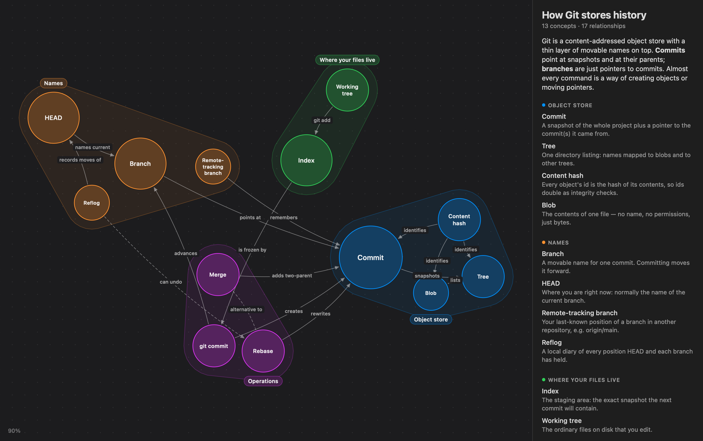

# Concept Graph

A way for an agent to answer in a picture. The agent works out what the concepts are and
how they relate, writes that as one JSON file, and a native macOS window shows it as
bubbles and labelled arrows that the user can zoom, pan, search and click to inspect.



There are two parts:

- **The viewer** — a small AppKit app (`Sources/ConceptGraph`). It starts when an agent
  asks for it, follows the JSON file while it is open, and exits when the user closes
  the window.
- **The skill** — `skill/SKILL.md`, which teaches an agent the file format, how to drive
  the viewer, and how to project a conversation (or any part of one) into a graph.

The agent never chooses coordinates, sizes or colours. That split is the point: the
agent reasons, the framework draws.

## Quick start

Requires macOS 14 or later and the Xcode Command Line Tools (`xcode-select --install`).
Xcode itself is not needed.

```bash
make                    # build the viewer into skill/bin/  (~30 s)
skill/scripts/concept-graph open skill/examples/git-internals.json
make check              # smoke tests
make install            # optional: link the skill into ~/.claude/skills for every project
```

Inside this repository the skill is already available to Claude Code through
`.claude/skills/concept-graph`, a link to `skill/`.

## Using it

Ask in plain words, at any point in a conversation:

- "Map this conversation as a concept graph."
- "Put just the options we compared into bubbles."
- "Show me how the auth module fits together."
- "Add what we just decided to the map."

or invoke it directly: `/concept-graph`, `/concept-graph the caching discussion`.

In the window:

| | |
|---|---|
| Zoom | pinch, ⌘-scroll, a mouse wheel, ⌘+ / ⌘−, or the toolbar |
| Pan | two-finger scroll, drag the background, or the arrow keys |
| Inspect | click a bubble: its explanation and connections appear in the inspector |
| Follow a connection | click a concept's name in the inspector |
| Focus | double-click a bubble to frame it with its neighbours |
| Rearrange | drag a bubble; it stays where you put it |
| Find | ⌘F, type, Return to step through matches |
| Fit everything | ⌘0 |

Zooming is semantic as well as optical: far out you see the groups and the big ideas;
closer in, arrow labels appear; closer still, each bubble shows its one-line summary.

## How it fits together

```
 agent ──writes──▶ graph.json ◀──watches── viewer process ──▶ window
   │                                            ▲
   └── concept-graph open graph.json ───────────┘  (validates, starts it detached, returns)
```

- `open` validates the file, starts the viewer as a separate detached process and
  returns in a fraction of a second, so the agent is never blocked by an open window.
- The viewer polls the file. Rewriting it updates the window in place: surviving bubbles
  keep their positions, new ones settle in beside what they connect to.
- One file, one window. Each viewer holds a file lock for its lifetime, so running
  `open` again on the same file refreshes and raises the existing window instead of
  opening another. The lock disappears with the process, so it cannot go stale.
- A file that fails to parse mid-session never blanks the window: the last good version
  stays up with a banner saying what is wrong.

## The graph file

The format is documented once, in [`skill/SKILL.md`](skill/SKILL.md), because that is the
copy agents read. In short:

```json
{
  "title": "Why the build is slow",
  "summary": "Three causes, one root.",
  "nodes": [
    { "id": "cold-cache", "label": "Cold cache", "importance": 5,
      "summary": "Every CI run starts from nothing.", "detail": "Longer **Markdown** text." },
    { "id": "rebuild", "label": "Full rebuild", "summary": "No incremental compilation." }
  ],
  "edges": [ { "from": "cold-cache", "to": "rebuild", "label": "forces" } ]
}
```

`skill/examples/` has two complete graphs: an explanation of a topic
(`git-internals.json`) and a projected conversation (`conversation.json`).

## Command line

```
concept-graph open <graph.json> [--wait]     show it (returns immediately; --wait blocks until closed)
concept-graph validate <graph.json>          report every problem, by JSON path
concept-graph render <graph.json> --out <image.png> [--size 1600x1000] [--light|--dark]
concept-graph close <graph.json>             close that file's window
```

`validate` is written for agents: errors say where and what
(`edges[4].to: no node has id "cach" — did you mean "cache"?`), and field names borrowed
from other formats (`source`, `target`, `name`, `weight`) are pointed at the right one.
`render` draws the same views to a PNG without opening a window, so an agent can look at
its own graph.

## Layout of the repository

```
Sources/ConceptGraph/
  main.swift                      command-line entry point
  GraphModel.swift                the file format: model, parser, diagnostics
  Layout.swift                    force-directed layout
  CanvasView.swift                drawing, zoom/pan, selection, animation
  InspectorViewController.swift   the reading pane
  Viewer.swift                    app, window, toolbar, menus, live reload
  Launcher.swift                  detached start, one-window-per-file lock
  Snapshot.swift                  render to PNG
  Theme.swift                     colours, fonts, text typesetting
skill/                            the skill: SKILL.md, launcher script, examples, bin/ (built)
scripts/build.sh                  builds with plain swiftc
scripts/check.sh                  smoke tests
```

## Limits

- macOS 14+ only.
- The channel is one-way. The window shows what the agent wrote; it does not report the
  user's clicks or rearrangements back to the agent.
- Graphs are flat: bubbles can be grouped, but a bubble cannot contain other bubbles.
- The canvas is custom-drawn, so VoiceOver reads the inspector (which lists every
  concept and connection) but not the bubbles themselves.
