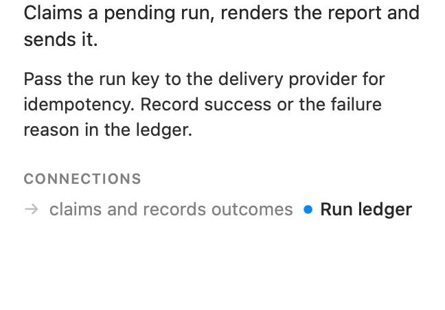

#  Concept Graph

Ask an agent to map a conversation, explain a codebase, or sketch a system design. A remote agent can save the answer as a single graph document in your repository. Open it on your Mac to inspect each concept, follow the relationships, or drag the bubbles into an arrangement that helps you think.


## Install the skill on Linux or a remote Mac

Paste this prompt into the **agent chat on the machine where you want the skill installed**. On a Linux server, that can be the agent running in your SSH session.

```text
Install Concept Graph for the agent I'm using on this machine. On Linux, set
it up to create .conceptgraph files here, including over SSH. I'll use the
viewer on my Mac. Use the latest stable release from
https://github.com/briansynthetaic/agent-concept-graph.git
Reuse a matching checkout or clone it into ~/.local/share/agent-concept-graph.

From the checkout, run `make install AGENT=codex` for Codex or
`make install AGENT=claude` for Claude Code. For another agent, pass its user
skills directory as SKILLS_DIR. On Linux this builds the headless CLI for
`save` and `validate`. If the Swift 5.9+ compiler or Perl is missing, run
`make install-skill` with the same arguments so I can still write graph JSON.
If Make is missing, link the checkout's skill/ directory as concept-graph
in the agent's user skills directory.

Set `skill` to the absolute path of the installed link and check that
"$skill/SKILL.md" is readable. If the CLI was built, validate the bundled graph with
"$skill/scripts/concept-graph" validate "$skill/examples/report-delivery.json"
Tell me the installed path and whether CLI validation passed or was skipped.
```

## Open your first graph on your Mac

You'll need macOS 14 or later, Homebrew, and the Xcode Command Line Tools. If you need the tools, run `xcode-select --install` in Terminal and let the installer finish.

**In Terminal**, install the viewer and its bundled skill.

```sh
brew install briansynthetaic/tap/concept-graph
```

Run the link command for each agent you use.

| Agent | Terminal command |
|---|---|
| Claude Code | `concept-graph link claude` |
| Codex | `concept-graph link codex` |
| Another agent with linked skills | `concept-graph link --dir "/path/to/skills"` |

**In a conversation you want to map**, ask your agent:

> map this conversation to a concept-graph.

Start a fresh agent session if the skill was installed while your chat was open. You can also type `/concept-graph` in Claude Code or `$concept-graph` in Codex followed by your request. Invoking the skill by itself maps the conversation so far.

## Run the agent on Linux and view the graph on your Mac

After installing the skill with the prompt above, start your agent in the
project directory on Linux and ask it to save a graph. A skill-only install
can write the graph JSON directly for validation on your Mac.

> Map the report delivery flow and save it as `./delivery.conceptgraph` in this repository.

The agent returns the absolute Linux path. In a **local Terminal tab on your
Mac**, run the following with your usual SSH host and that path. Here
`devbox` is the SSH alias and `/home/alex/reports` is the project on Linux.

```sh
scp 'devbox:/home/alex/reports/delivery.conceptgraph' ./ && concept-graph open ./delivery.conceptgraph
```

You can keep the SSH session open. To see a later edit, repeat the copy into
the same local folder. The viewer follows that local file. If you already
synced the graph through the repository, just run the open command in your
Mac checkout. For a source-installed Mac viewer, use its
`skill/scripts/concept-graph` launcher.

### Generate the document from a script on Linux

The agent can pipe JSON from a transform to `save`. This example writes the
graph in the caller's working directory.

```sh
CG=~/.agents/skills/concept-graph/scripts/concept-graph  # Codex source install
"$CG" save ./delivery.conceptgraph <<'JSON'
{
  "title": "Report delivery",
  "nodes": [
    {"id": "planner", "label": "Planner", "summary": "Queues each scheduled report."},
    {"id": "worker", "label": "Worker", "summary": "Delivers the queued report."}
  ],
  "edges": [{"from": "planner", "to": "worker", "label": "queues work for"}]
}
JSON
```

`save` checks the input with the viewer's parser and writes the original JSON
bytes. A successful save atomically replaces the destination. Invalid input
leaves any previous version intact. An agent that writes its own file can
check it with `"$CG" validate ./delivery.conceptgraph`.

## Follow a delivery from schedule to outcome

1. Open the graph from the request above. To follow the exact example illustrated here from a source checkout, run `make demo`.
2. Click **Delivery worker**. Its inspector explains the run key that makes a retry safe. Click **Run ledger** under Connections to see what happens to an expired claim.

   

3. Right-click **Delivery worker** and choose **Compose Agent Prompt…**. Ask “If delivery succeeds but the ledger write fails, how does a retry avoid sending twice?” Preview the prompt, copy it and paste it into the same agent chat. **Expand the graph** includes the document path so the agent can add the answer to the open graph.
4. Choose **Build this system (whole graph)** to copy an implementation prompt that includes every component, relationship and reference in the design.

## Keep a graph on your Mac

Choose **File → Save As…** (⇧⌘S) to keep a scratch graph as a named `.conceptgraph` or `.json` file. The copy opens in its own window with its own prompt path. Your original window continues to follow the original file. If the agent's latest edit is invalid or the file has disappeared, **Save Last Valid Revision** saves the revision you can still read.

Drag a bubble to pin it. Move it inside the group to change its position. The outline can stretch about one bubble diameter before it starts pulling the group along. Hold beyond that distance to let the group catch up. Previously pinned group members travel with the group and keep their pins. A moving outline pushes neighboring bubbles and groups aside on contact, including previously pinned bubbles. Release to freeze the arrangement immediately. To let the whole graph respond to a drag, choose **Move Whole Graph** under **Settings… → Bubble dragging**. Concept Graph keeps positions, camera and selection in your Mac user's Application Support folder, keyed to the graph's path. Agent edits preserve surviving IDs. Save As copies the arrangement. A colleague who receives just the JSON gets a fresh layout.

Reopen a document with **File → Open…** (⌘O), **Open Recent**, or by opening a `.conceptgraph` file in Finder. Linking a Homebrew installation registers the bundled viewer with Finder. If Finder asks for an application, choose the built **ConceptGraph.app**. Both the open panel and CLI also accept ordinary graph JSON.

**File → Export PNG…** shows the output dimensions. **Current View** exports the canvas at your current zoom and pan. **Whole Graph** fits all the bubbles using their live positions.

## Navigation and shortcuts

| To | Do this |
|---|---|
| Read a concept | Click its bubble. Follow a connection by clicking its name in the inspector. |
| Explore a neighborhood | Double-click a bubble or press Return on the canvas. Use arrow keys to visit the concept and its neighbors. Escape restores the previous camera. |
| Ask about several concepts | Shift-click bubbles or use Shift–arrow on the canvas. Press ⇧⌘P, choose whether to include neighbors, and review the prompt. |
| Find a concept | Press ⌘F, type a term, then press Return to step through matches. |
| Move around | Scroll up to zoom in or down to zoom out at the pointer. You can also pinch to zoom. Drag the background to pan, or press ⌘0 to fit the graph. |
| Release a bubble | Right-click a pin and choose **Unpin**. **View → Reset Layout** releases all pins and recomputes positions. Use ⌘Z to undo it. |
| Adjust the drawing | Under **View**, choose when relationship labels appear and whether to show group regions. |
| Change shapes or motion | In **Concept Graph → Settings…** (⌘,), choose circles or rounded rectangles. Motion follows the system preference by default. |

The inspector includes a text outline for VoiceOver. The canvas announces the selected concept during keyboard exploration.

## Update or uninstall

For Homebrew, run `brew upgrade concept-graph` and reopen your graph windows. Before uninstalling, run `concept-graph unlink claude`, `concept-graph unlink codex`, or `concept-graph unlink --dir "/path/to/skills"` for each agent you linked. Then run `brew uninstall concept-graph`.

For a source installation, run `git pull --ff-only && make` in the original checkout, then reopen graph windows. Use `make uninstall` for Claude Code, `make uninstall AGENT=codex` for Codex, or the original `SKILLS_DIR` for a custom agent. When switching installations, unlink the old one first.

## Build and check the source

```sh
git clone https://github.com/briansynthetaic/agent-concept-graph.git
cd agent-concept-graph
make
```

Use `make install` to link Claude Code, `make install AGENT=codex` for Codex, or `make install SKILLS_DIR="/path/to/skills"` for another agent. The links point to this checkout. On macOS the built app is in `skill/bin/ConceptGraph.app`.

From the checkout, try the CLI with a disposable copy.

```sh
CG=./skill/scripts/concept-graph
work=$(mktemp -d)
cp skill/examples/report-delivery.json "$work/delivery.json"
"$CG" validate "$work/delivery.json"
"$CG" open "$work/delivery.json"
"$CG" render "$work/delivery.json" --out "$work/delivery.png" --size 1200x800
"$CG" close "$work/delivery.json"
```

`open` returns when the window is ready. Add `--wait` to wait for that window to close. Reopening the same file focuses its window. The CLI render size is in points. At two pixels per point, the example produces a 2400 × 1600 PNG with the inspector.

Run `make check` on Linux or macOS to test saving and validating portable documents. On macOS it also checks offscreen rendering, documents, prompts and viewer commands. Run `make check-build` on a Mac to exercise concurrent first builds and a failed rebuild in a disposable checkout. On a logged-in Mac, `make check-windows` exercises the window lifecycle and Finder opening with a temporary document. `make benchmark` times the first offscreen frame, revision processing, and simulated drag frames on sparse and denser maps.

See the [delivery system](skill/examples/report-delivery.json), [Git walkthrough](skill/examples/git-internals.json), [conversation map](skill/examples/conversation.json), [agent skill](skill/SKILL.md), and [graph format](skill/references/format.md).
